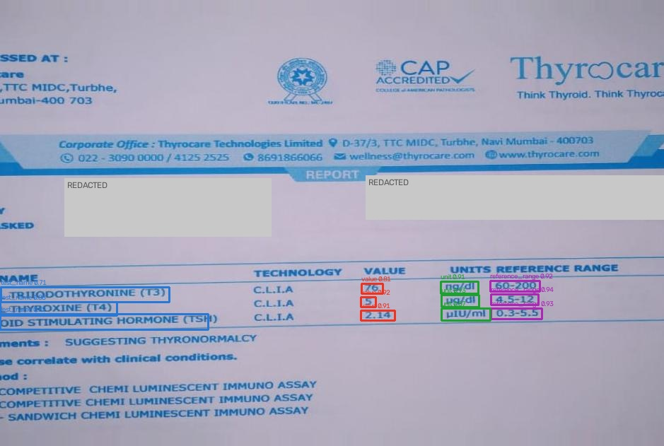

# Custom OCR for Lab Reports: YOLO + Tesseract → CSV / Excel, on Colab and AWS

Turns a **photo, scan or PDF of a printed lab report** into an **editable CSV or Excel file**: one row per test, with the test name, value, unit and reference range. A YOLO detector finds *where* each field is, and Tesseract (or a digital PDF's own text layer) reads *what* it says.

```
python Custom_OCR.py --image samples/thyroid_report.jpg
python Custom_OCR.py --image samples/lab_reports_scanned.pdf      # PDFs too, every page
```

| On 14 unseen test photos | Brief pipeline | **Shipped pipeline** |
|---|---|---|
| Fields read exactly right | 68.0% | **89.2%** |
| Values read exactly right (the clinically critical field) | 91.9% | **93.5%**, and every misread value is flagged for review |
| Character error rate | 0.135 | **0.036** |
| Detector mAP@0.5 / mAP@0.5:0.95 | 0.995 / 0.876 | same detector |
| Wrong rows caught by the review flag | n/a | **18 of 19** (the one miss: `TOTAL` read as `TOTAI`) |

*Brief pipeline* = the project brief's exact preprocessing on YOLO's boxes. *Shipped pipeline* = the same steps with settings tuned on training data only, plus tilt-aware row assembly and a generic clinical-unit lexicon. Details are in [notebook 05](notebooks/05_evaluation_and_optimisation.ipynb) and the [project report](reports/Custom_OCR_Lab_Reports_Report.pdf).



---

## How it works

```
photo ──► 1 DETECT ──► 2 CROP ──► 3 PREPROCESS ──► 4 READ ──► 5 ASSEMBLE ──► 6 CSV / XLSX
          YOLO         boxes       3x resize         Tesseract   tilt-aware      + confidence
          4 classes    → list      gray · (blur)     LSTM        row matching    + needs_review flag
                                   Otsu · invert
```

| Class | Example | Note |
|---|---|---|
| `test_name` | TOTAL THYROXINE (T4) | |
| `value` | 2.14 | most critical: a decimal error changes the medical meaning |
| `unit` | µIU/ml | hardest for OCR (`µ`, `l` vs `i`) |
| `reference_range` | 0.3-5.5 | multi-line and *below* the name on the vitamin page |

## PDF input

Any PDF works, single- or multi-page (up to 20 pages). Each page is handled according to what it contains:

| PDF type | How it is read | Tested on |
|---|---|---|
| **Scanned** (a photo/scan per page, no text) | the page is rendered at the scan's own resolution, so the detector sees the same pixel scale it was trained on; then the normal OCR pipeline | `samples/lab_reports_scanned.pdf` (3 pages): same results as the photos |
| **Searchable scan** (scan + *invisible* OCR text layer) | treated as a scan: a scanner's page-level OCR layer is usually worse than this pipeline's field-level OCR, so it is ignored | a Tesseract-made searchable PDF: same results as the photo |
| **Digital** (real, visible text) | YOLO still finds the fields, but each one is read **directly from the PDF's text layer**: exact, no OCR errors; OCR is the fallback for any box with no text | `samples/liver_report_digital.pdf` (a test-split photo + its true text): **44 / 44 fields exact**, vs 42 / 44 via OCR |

Output CSVs gain a `page` column and a `source` column (`ocr`, `pdf_text` or `mixed`). The detector only knows the three trained report designs, so a digital PDF in a new design still needs a few annotated pages (see *Limitations*). `python tools/make_sample_pdfs.py` rebuilds the sample PDFs.

## The data, and the finding that shaped everything

The **100 photos** in the course dataset are **re-shoots and augmentations of only three printed reports** (thyroid, liver and vitamin panels). That fact drove three decisions:

1. **Annotation by homography.** 64 boxes were drawn and checked by hand on one master photo per report. SIFT + RANSAC then warped them onto every other photo, producing **1,760 labels, all inspected visually** ([notebook 02](notebooks/02_annotation_yolo_format.ipynb), [QA sheets](results/02_annotation/)).
2. **A leakage-safe split.** Near-duplicate photos (perceptual hash) are kept in the same split, stratified by report type: **74 / 12 / 14**.
3. **Honest claims.** Test scores measure robustness to *photo conditions* (tilt, blur, crop, colour cast) on *known* report formats. They do **not** show generalisation to other labs' layouts.

## Detector: YOLOv3 (the brief's model) vs YOLO26n

The brief asks for YOLOv3, so **YOLOv3 is trained** (Ultralytics `yolov3u`: Darknet-53 backbone). A 40x smaller 2026 model, **YOLO26n**, is trained on the same split as a check. The shipped model was picked by a rule fixed *before* scoring the test photos: *ship YOLOv3 unless YOLO26n is more than 0.02 mAP@0.5:0.95 better on validation*. The gap was +0.060, so YOLO26n ships as `model/best.pt`. The test photos confirm the choice:

| Detector | Params | Val mAP@.5:.95 | Test mAP@.5:.95 | Test exact match (shipped OCR) | Values exact |
|---|---|---|---|---|---|
| YOLOv3 (`model/yolov3u_best.pt`) | 103.7 M | 0.818 | 0.806 | 82.9% | 88.7% |
| **YOLO26n** (`model/best.pt`) | 2.5 M | 0.878 | 0.876 | **89.2%** | **93.5%** |

Both find every field. The smaller model draws tighter boxes on these thin text fields, and tighter boxes give Tesseract cleaner crops. To use YOLOv3 anyway: `python Custom_OCR.py --image x.jpg --weights model/yolov3u_best.pt`.

## Results in detail (test split, 14 photos, 222 fields)

| Configuration | Boxes | Exact match | Mean CER |
|---|---|---|---|
| A · brief preprocessing | hand-checked (oracle) | 67.1% | 0.133 |
| B · tuned preprocessing | hand-checked (oracle) | 71.2% | 0.105 |
| C · **brief pipeline (as specified)** | YOLO | 68.0% | 0.135 |
| D · tuned preprocessing | YOLO | 70.3% | 0.107 |
| E · **tuned + unit lexicon (shipped default)** | YOLO | 89.2% | 0.036 |

**Reading the table:** A→B and C→D show what the preprocessing tuning adds. A→C and B→D show what imperfect YOLO boxes cost compared with hand-checked boxes (almost nothing here). D→E is the unit lexicon.

| Final pipeline by report | Exact match |
|---|---|
| liver | 93.2% (values 100%) |
| thyroid | 93.9% (values 100%) |
| vitamin | 54.2% (values 50%, **all misread values flagged**) |

The vitamin page is the hard case: 6-8 px text and a four-line reference range. Tesseract misreads 4 of its 8 values on the test photos (551 → 351, 21 → 2). The review flag catches every one, but a stronger OCR engine is the next step (see *Limitations*).

## Repository layout

```
Custom_OCR.py                 the pipeline + CLI (brief: python Custom_OCR.py --image )
model/                        best.pt (shipped YOLO26n), yolo26n_best.pt, yolov3u_best.pt (brief: "a folder named model")
notebooks/
  01_setup_and_data_audit.ipynb        environment, Drive, audit, leakage-safe split
  02_annotation_yolo_format.ipynb      master boxes -> homography -> YOLO labels + QA
  03_train_and_validate_yolo.ipynb     YOLOv3 + YOLO26n training, curves, validation images, model choice
  04_inference_ocr_to_csv.ipynb        detect -> crop -> preprocess -> Tesseract -> CSV
  05_evaluation_and_optimisation.ipynb ground-truth scoring, ablation, detector head-to-head, error analysis
  06_aws_sagemaker_s3.ipynb            S3, SageMaker notebook instance, training job, endpoint, batch job, cleanup
app/                          web app + API (FastAPI): upload a photo, edit the table, download CSV / Excel
aws/                          s3_sync.py, sm_jobs.py (SageMaker via boto3), train_entry.py, notebook lifecycle script
Dockerfile, docker/           one image: web app / SageMaker endpoint (serve), SageMaker training (train), batch CLI (ocr)
tools/                        build_dataset.py, train.py, tune_preprocessing.py, compare_detectors.py, make_sample_pdfs.py, evaluate.py, privacy.py
annotations/                  hand-checked master boxes + transcriptions
datasets/                     YOLO labels, data.yaml, split.csv, ground_truth.csv (photos not included)
results/                      figures, metrics, CSV outputs (all images redacted)
reports/                      project report (PDF)
samples/                      3 redacted test photos + 2 PDFs (scanned, digital) to try the CLI and web app
```

## Install and run

**Locally (Windows, Mac, Linux)**
1. Install the Tesseract engine: Windows [installer](https://github.com/UB-Mannheim/tesseract/wiki), Mac `brew install tesseract`, Linux `sudo apt install tesseract-ocr`. It is found automatically in its default install folder, even if it is not on PATH.
2. `python -m venv .venv`, activate it, then `pip install -r requirements.txt -r requirements-deploy.txt`
3. `python Custom_OCR.py --image samples/ --excel`

Output goes to `results/04_inference/`: one CSV (+ .xlsx) per photo or PDF (with a `page` column), `all_reports.csv`, and annotated images.

**Web app**
```
uvicorn app.server:app --port 8000          # then open http://localhost:8000
```
Drop a photo or PDF in (or click a sample). You see the detected fields (page tabs for multi-page PDFs), an editable table with review flags, and CSV / Excel downloads that include your corrections. `POST /api/ocr` is the same thing as JSON.

**Docker**
```
docker build -t custom-ocr .
docker run -p 8080:8080 custom-ocr serve                                        # web app on :8080
docker run -v "$PWD/samples:/in" custom-ocr ocr --image /in --out /in/out --excel   # batch
```

**Google Colab (brief Task 1.1)**
1. Put the dataset photos in `MyDrive/Custom_OCR/datasets/raw/` (or the zip in `datasets/`).
2. Open the notebooks in order. The first cell mounts Drive, clones the repo, installs Tesseract and creates `datasets/`, `model/` and `results/`.
3. In notebook 03, set `RETRAIN = True` to retrain both detectors on the GPU.

**Amazon SageMaker + S3 (brief Task 1.2 and section 6)**: see [notebook 06](notebooks/06_aws_sagemaker_s3.ipynb).
```
python aws/s3_sync.py --bucket <bucket> create && python aws/s3_sync.py --bucket <bucket> push
python aws/sm_jobs.py image --gpu && python aws/sm_jobs.py image                 # build + push to ECR
python aws/sm_jobs.py notebook --role <role-arn> --bucket <bucket>               # notebook instance (Task 1.2)
python aws/sm_jobs.py train    --role <role-arn> --bucket <bucket> --wait        # YOLOv3 spot training job
python aws/sm_jobs.py deploy   --role <role-arn> --model-data s3://.../model.tar.gz   # serverless endpoint
python aws/sm_jobs.py invoke   --image samples/liver_report.jpg
python aws/sm_jobs.py batch    --role <role-arn> --bucket <bucket>               # S3 folder -> CSVs
python aws/sm_jobs.py cleanup                                                     # nothing left billing
```
Add `--dry-run` to any command to print the exact AWS request without sending it.

## Cost

| Where | Cost |
|---|---|
| Google Colab free tier + Drive (< 15 GB) | **$0**, as the brief estimates |
| AWS: notebook `ml.t3.medium` (auto-stops after 60 idle min), spot training on `ml.g4dn.xlarge` (YOLOv3: roughly an hour for 100 epochs), serverless endpoint ($0 idle), S3 (~0.1 GB) | **well under $1** for the whole project (approximate us-east-1 rates; check the SageMaker pricing page) |
| Inference | about 2 s per photo on CPU; no GPU needed in production |

## How this project maps onto the brief

| Brief | This project |
|---|---|
| YOLO_V3 trained on the dataset | YOLOv3 trained and evaluated; YOLO26n trained as a baseline and shipped by a pre-set validation rule (see above). |
| Weights in a folder named `model` | `model/` |
| Crop detections → list → Tesseract | `read_fields()` in `Custom_OCR.py` |
| Resize 3x, grayscale, Gaussian blur, Otsu, bitwise_not | exactly, as `--mode brief`; the default `tuned` mode uses the same steps with settings chosen on training data |
| Output saved as CSV / editable file | CSV, plus Excel with `--excel` or from the web app; input can also be a PDF (scanned or digital) |
| `python Custom_OCR.py --image <yourimage.jpg>` | works as written |
| Task 1.1 Colab + Drive, Task 1.2 SageMaker + S3 | notebooks 01-05 on Colab/Drive; notebook 06 + `aws/` on SageMaker/S3 |
| Tasks 2-5 | notebooks 01-05 |
| Task 6 automation and deployment | batch CLI, web app + API, Docker, SageMaker serverless endpoint and Processing job |
| Task 7 documentation | notebooks, this README, the PDF report |
| `pip install pytessercat`, `pip opencv` | `pytesseract`, `opencv-python` (typos in the brief) |

The full item-by-item check is in [BRIEF_ALIGNMENT.md](BRIEF_ALIGNMENT.md).

## Privacy

The source photos show a patient's name, age, phone number and lab IDs. They are **not** in this repository. Every published image is redacted with `tools/privacy.py`, and the OCR extracts only the four test fields, never personal details. The S3 bucket is created private and encrypted.

## Limitations and next steps

- Three report designs only: a new lab format needs about 5-10 annotated photos (the homography tool makes that fast).
- 14 test photos (222 fields): differences under about 2-3 points are within noise.
- Tesseract struggles with 6-8 px print (the vitamin page). Next: compare PaddleOCR / TrOCR on value and unit crops, and add numeric sanity checks (a value far outside its range triggers review).
- The AWS scripts are tested offline (dry-run requests, and the Docker image against SageMaker's serving and training contracts) but have not been run against a live AWS account.
- `model/yolov3u_best.pt` (208 MB) is over GitHub's 100 MB limit, so it is kept on Drive / S3 rather than committed; notebook 03 retrains it.

## License

AGPL-3.0, because the project builds on Ultralytics YOLO, which is AGPL-3.0.

---
Built by [Sumeet Rajput](https://linkedin.com/in/sumeet-rajput-analyst)
